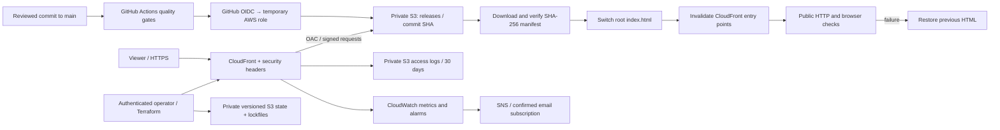

# Architecture and engineering decisions

This is a static React streaming **demo**, used as a workload for a cloud delivery platform. The catalog is fictional; there is no video transcoding, subscription billing, login, DRM, or backend service. Avoid presenting this as a production Netflix replacement.

## Content delivery

S3 is an object origin, not a public website. Origin Access Control signs requests. The content bucket blocks public access and only permits CloudFront reads from this distribution, plus separately authorized same-account operators/deploy role. Both buckets require TLS. S3-managed encryption and content-bucket versioning are enabled.

Each deployed commit builds with `ASSET_BASE=/releases/<full-sha>/`. All JS, CSS, fonts, images, and video live under that prefix. They are cached as immutable for one year. Root `index.html` is a small, noncached pointer to one completed release. Activation replaces that object only after stored objects pass SHA-256 verification; invalidation evicts `/` and `/index.html`. Browsers that already hold older HTML can still load its original assets. A manifest is uploaded last as the completion marker; completed releases are never overwritten by normal reruns. S3 versioning is a second layer of recovery, not the routine rollback mechanism.

There is a propagation interval; changing HTML is atomic in S3, but not instantaneous globally. The public smoke check verifies the release identity, not merely HTTP 200. Deployment jobs are serialized through one workflow concurrency group. Operator deployments outside this workflow must be serialized too. Immutable releases are retained indefinitely; monitor storage and prune only manually reviewed releases that are no longer referenced or needed for rollback. Noncurrent object versions expire after 30 days.

## Identity and pipeline boundaries

OIDC trust requires `aud=sts.amazonaws.com` and the exact `repo:techstar17/netlify:environment:production` subject. The GitHub `production` environment must restrict deployment to `main`; without that rule, other refs can request the environment subject. Review workflow changes like application code, protect main, and use environment reviewers where available. This configuration cannot enforce your GitHub account's settings through Terraform.

The deployment role has object read/write on only the site's release prefix and root index, bucket listing, and invalidation/distribution inspection on one CloudFront distribution. No wildcard IAM actions, static AWS credentials, resource deletion, or infrastructure-administration permissions are granted. The operator provisions Terraform separately using an authenticated session. S3 remote state is private, encrypted and versioned, with native S3 lockfiles. This project does not create an admin CI role.

GitHub Actions are pinned to commit SHAs, npm dependencies/provider versions are locked, Dependabot proposes updates, npm audit gates high/critical advisories, Gitleaks scans repository history, Terraform mock tests assert key security invariants, and Playwright exercises a real production build. This is not a complete penetration test, external IaC compliance audit, or supply-chain attestation. CI gates both Pages and AWS delivery. Reusable quality jobs also run independently on PRs/pushes, so some duplicate CI runs are intentional.

## Transport and browser security

HTTP redirects to HTTPS. CloudFront adds HSTS, a same-origin CSP, nosniff, frame denial, referrer restrictions, and disabled camera/microphone/geolocation. React currently uses inline style attributes, so CSP permits inline styles, while scripts remain same-origin with no inline exception. No third-party runtime assets are required.

The default `*.cloudfront.net` certificate is convenient but has AWS's fixed legacy minimum TLS policy. AWS ignores stronger minimum protocol settings with that default certificate. Use a validated us-east-1 ACM certificate plus a custom domain to enforce `TLSv1.2_2021`; the stack supports both together. DNS/certificate ownership and validation must be completed separately. No WAF or custom domain is silently purchased.

## Operations and cost

The S3 origin region is configurable, including us-east-2; a separate us-east-1 provider handles global CloudFront monitoring and SNS. CloudWatch exposes Requests, BytesDownloaded, and 4xx/5xx error rates. Sustained 5xx >1% or 4xx >5% over two five-minute periods publish to SNS. Low traffic can produce noisy percentages; missing traffic is treated as nonbreaching and is not uptime evidence. Deployment health checks are not continuous synthetic monitoring. The SLO in the runbook is a proposed target, not a measured history.

Standard CloudFront access logs go to a separate private S3 bucket and expire after 30 days. Legacy standard logging requires ACL-enabled BucketOwnerPreferred ownership there; only the owner and AWS CloudFront log-delivery canonical user get FULL_CONTROL. The application/state buckets do not use those ACLs. Logs are delayed/best-effort and can contain client IPs and URLs: restrict operator access and review privacy needs. Infrastructure-management API auditing relies on your account's CloudTrail configuration, which this stack does not create or verify.

PriceClass_100 limits edge-location coverage to reduce cost. A $10/month default project budget sends 80%/100% notifications when an email is supplied; it is not a cap. Activate the Project cost-allocation tag in Billing or the filtered budget will miss costs. Shared or untaggable charges may fall outside the filtered budget, so inspect account-level costs too. Traffic, video egress, logs, metrics/alarms, and storage can incur charges. No availability, cost, or recovery claims are made before live validation.
